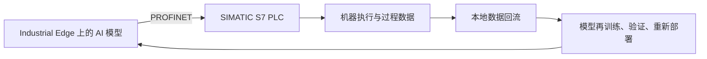
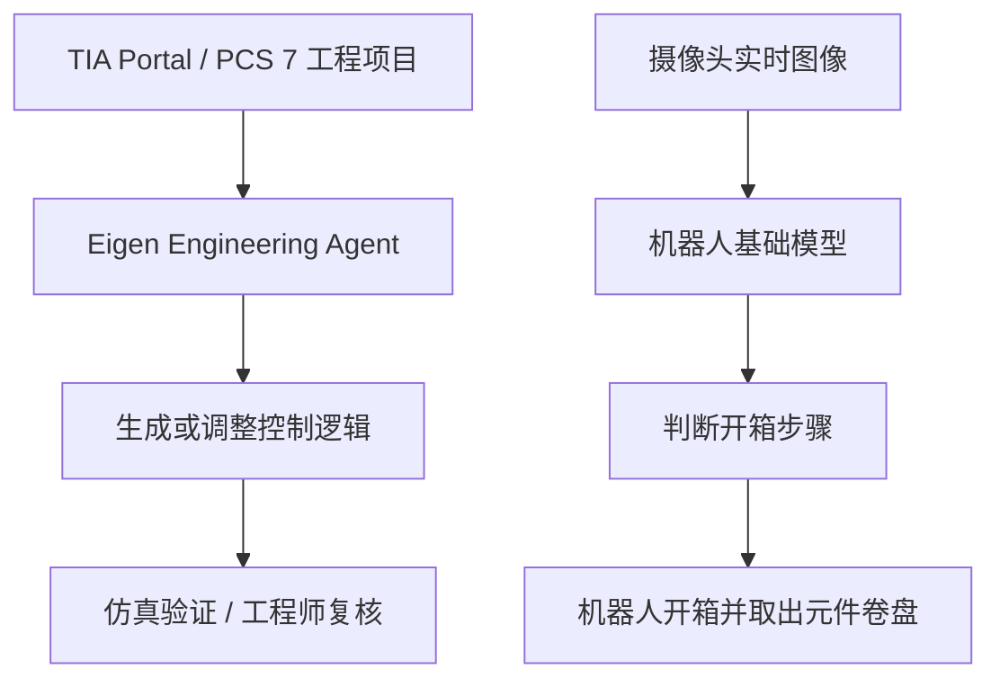
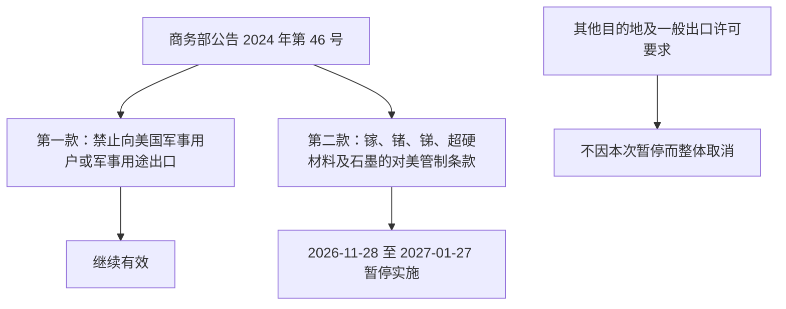

# 每日兴趣与重要新闻简报｜2026-11-25

**覆盖周期：** 2026-11-24 至 2026-11-25 08:52（北京时间）  
**精选：** 5 条。按技术影响、产业落地与宏观影响综合排序。

---

## 1. Google DeepMind：Gemini 4 多智能体在 Lean 形式化验证下改进量子算法

**发布日期：2026-11-23（DeepMind 博客）；论文 v3 更新于 2026-11-16。**

DeepMind 公布了一套由 Gemini 4 智能体团队协作搜索量子算法的流程：不同团队独立提出改进方案，先用 Lean 定理证明器验证程序正确性，再将结果写入共享知识库；智能体每四小时举行一次虚拟讨论会，比较和组合方案。DeepMind 同时开放了 Lean 4 量子程序形式化库、问题规格和已验证解答。

官方报告的改进包括：

| 任务 | 报告结果 |
|---|---:|
| 惯性约束聚变相关模拟 | 计算成本降低 11.8 倍；所需纠错量子比特由 5,650 降至 4,338 |
| 光化学模拟 | 计算成本降低 8 倍 |
| 细胞色素 P450 酶模拟 | 计算成本降低 2.5 倍；所需量子比特由 481 降至 333 |
| Grover 算法特定实现 | 速度提升 2.57 倍 |
| arcsin 算术子程序 | 速度提升 290 倍 |

这里的“计算成本”是量子比特数与运算量的综合指标，不等于实际运行时间。DeepMind 也明确指出，即使优化后，相关科学模拟仍需要超过首批容错量子计算机可能提供的资源；这些结果是经过形式化证明的算法改进，不是已经在真实量子硬件上跑出的应用结果。


*图片：DeepMind 官方研究文章配图。来源：[Finding faster quantum algorithms with agents and formal verification](https://deepmind.google/blog/finding-faster-quantum-algorithms-with-agents-and-formal-verification/)*

**为什么值得关注：** 重点不只是某个量子算法的倍数提升，而是“多智能体搜索—形式化证明—共享知识—继续搜索”的研究范式。它把 AI 的探索能力与 Lean 的正确性约束结合起来，避免只凭模型自我判断结果是否正确。对 AI 辅助软件工程、协议实现和其他高可靠计算任务也有方法论参考价值。

- 官方说明：[Google DeepMind](https://deepmind.google/blog/finding-faster-quantum-algorithms-with-agents-and-formal-verification/)
- 论文：[arXiv:2611.09822](https://arxiv.org/abs/2611.09822)
- AI 开源项目：[google-deepmind/formal-quantum-computation](https://github.com/google-deepmind/formal-quantum-computation)（Lean 4；量子 Hoare 逻辑、程序规格和资源计数；论文中的发现程序位于 discoveries 分支；Apache-2.0）

## 2. Siemens：把工业 AI 推进 TIA Portal、PCS 7 和 S7/PROFINET 控制链

**发布日期：2026-11-24；SPS 2026 展会发布。**

Siemens 公布了面向自主生产的一组工业 AI 能力，覆盖工程、生产计划和现场运行：

- **工程代理：** Eigen Engineering Agent 连接 TIA Portal，可辅助修改自动化代码并通过仿真验证；面向流程工业时还可连接 SIMATIC PCS 7，分析或创建连续功能图（CFC）及控制模块。
- **生产计划：** Intelligence Center X 中的 Autonomous Production Planner 由多个 AI Agent 协作生成排产方案，并先在基于物理模型的数字孪生中验证。Siemens 预计人工排产工作量可减少 70%，成本最多降低 20%；这是厂商预期值，不是独立评测结果。
- **现场控制：** Industrial Edge 上运行的 AI 模型可通过 PROFINET 连接 SIMATIC S7 控制器，在机器自动化过程中进行实时推理；生产数据可在本地用于模型再训练、验证和重新部署。
- **Physical AI：** Erlangen 电子工厂正在开发视觉 AI 机器人开箱方案，摄像头实时感知包裹，机器人基础模型判断操作步骤，再打开纸箱并取出元件卷盘。Siemens 明确称该应用仍在开发中。
- **数据底座：** Siemens 正向超过 120,000 种硬件产品提供标准化 Asset Administration Shell（AAS）数据，供软件和数字孪生工作流读取。

现场 AI 控制链可以概括为：



工程代理与机器人开箱是另外两条工作流，不应误认为都已形成同一条闭环：



**为什么值得关注：** 这不是简单地在 PLC 旁边加一个聊天窗口。更值得看的是 AI 模型部署在 Industrial Edge，再通过 PROFINET 与 S7 协作，PLC 仍承担控制系统角色；AI 推理被接入机器自动化链路。工程代理则开始触及控制逻辑修改和仿真验证。实际评估时仍要重点检查确定性时延、故障降级、安全联锁、变更审计和网络安全，不能把厂商演示等同于可直接用于安全关键闭环。

- 官方新闻稿：[Siemens Press Release，2026-11-24](https://press.siemens.com/global/en/pressrelease/siemens-advances-its-automation-portfolio-toward-ai-powered-autonomous-production)
- 官方新闻稿 PDF（第 4 页含机器人开箱现场图）：[Siemens PDF](https://assets.new.siemens.com/siemens/assets/api/uuid:050fd68e-93e0-468f-9a5e-765bf548b6d3/HQDIPR202611237507EN.pdf)

## 3. Anthropic：Claude Ship 将代码审查、修复和策略审批串成 Agent 工作流

**发布日期：2026-11-23。**

Anthropic 发布 Claude Ship，面向 GitHub Pull Request（PR）把代码审查后的修复和审批流程继续自动化。它由三部分组成：

- **Code Review：** 已正式提供，可从多个角度检查 PR，并对发现的问题进行对抗式复核后再提交意见。
- **PR Steward（Beta）：** 处理 CI 失败、合并冲突和审查反馈；每次推送后说明改了什么以及如何撤销。它被设计为不负责批准或合并 PR。
- **Claude Approvals（Beta）：** 根据仓库中的团队策略文件判断哪些常规改动可由 Claude 批准，哪些必须升级给人类审批。

开发者可在 Claude Code 中使用 /ship，让 Claude 推送代码、创建 PR、审查并处理反馈。管理员也可以按仓库启用，并设置审查深度、运行时机和预算上限。


*图片：Anthropic 官方 Claude Ship 流程图。来源：[Introducing Claude Ship](https://claude.com/resources/articles/introducing-claude-ship)*

**为什么值得关注：** AI 编程的瓶颈正在从“能否生成代码”转向“能否安全地把代码合并进主干”。Claude Ship 开始把审查、修复和策略审批连接起来，意味着 Agent 的权限边界正在从写代码扩展到软件交付治理。

**限制与风险：** 当前面向 Claude Team / Enterprise 和 GitHub 仓库；Code Review 已正式提供，PR Steward 与 Claude Approvals 仍处于 Beta。按 Token 计费；启用 Zero Data Retention、HIPAA 配置或客户自管加密密钥的组织不可用。Anthropic 建议先用 observe-only 模式观察审批判断，再考虑把它纳入分支保护规则；官方也明确提示 AI 可能漏掉 Bug 或安全漏洞。

- 官方发布：[Anthropic — Introducing Claude Ship](https://claude.com/resources/articles/introducing-claude-ship)
- 使用文档：[Claude Code 文档](https://code.claude.com/docs/en/claude-ship)

## 4. 中美 AI 供应链政策：美国新增 7 家实体，中国延长部分对美出口管制暂停

**发布日期：2026-11-23 至 2026-11-24。**

这两项政策不是同一措施，但都影响先进算力供应链和跨境贸易合规。

**美国：** 美国商务部工业与安全局（BIS）将 7 家位于新加坡、马来西亚和泰国的实体列入 Entity List，其中包括新加坡数据中心公司 Megaspeed、其相关公司，以及阿里巴巴新加坡子公司 Apex Enterprise Solutions。相关美国出口管制物项对这些实体需要申请许可证，审查原则为推定拒绝。BIS 给出的理由是存在先进计算产品流向未经授权最终用途或最终用户的重大风险。

**证据边界：** Entity List 是出口管制行政措施，不等于刑事定罪。Reuters 报道称相关调查仍在进行，Megaspeed 尚未被认定违反出口管制规定；阿里巴巴则称 Apex 从未转移受美国出口限制的先进芯片，并表示将寻求法律途径。


*图片：Megaspeed International 在新加坡办公室的标识，摄于 2026-11-10。摄影：Taryn Ng / AFP。来源：[Al Jazeera，2026-11-24](https://www.aljazeera.com/economy/2026/11/24/us-adds-megaspeed-firm-at-centre-of-nvidia-scandal-to-export-control-list)*

**中国：** 商务部 2026 年第 59 号公告决定，自 2026-11-28 至 2027-01-27，暂停实施 2024 年第 46 号公告第二款。该款涉及：原则上不予许可镓、锗、锑、超硬材料相关两用物项对美出口，以及对石墨两用物项对美出口实施更严格的最终用户和最终用途审查。

需要特别注意：2024 年第 46 号公告第一款——禁止两用物项向美国军事用户或军事用途出口——不在此次暂停范围内；一般性的出口许可管理也没有因此整体取消。



**为什么值得关注：** 一边是美国针对第三国数据中心与算力服务网络加强终端用户审查，一边是中国延长部分对美关键材料措施的暂停期。AI 算力供应链的风险已经不只是 GPU 能否买到，还包括服务器部署地点、云算力转租、最终用户穿透审查，以及镓、锗、锑、石墨等材料的贸易合规。

- 中国官方：[商务部公告 2026 年第 59 号，2026-11-24](https://aqygzj.mofcom.gov.cn/qdml/art/2026/art_98ae61c2a60f43638304f2e6a43f952f.html)
- 原始政策条款：[商务部公告 2024 年第 46 号](https://www.mofcom.gov.cn/zfxxgk/gkml/art/2024/art_99f5d51bbe6a412ca309d5818c4dee52.html)
- 美国措施：[Federal Register 文件 2026-23999](https://publicinspection.federalregister.gov/2026-23999.pdf)
- 马来西亚官方回应：[MITI Media Statement，2026-11-24](https://www.miti.gov.my/miti/resources/Media%20Release/THE_ADDITION_OF_MALAYSIAN_ENTITIES_TO_THE_US_ENTITY_LIST_-_UNDER_BUREAU_OF_INDUSTRY_AND_SECURITY_OF_THE_US_DEPARTMENT_OF_COMMERCE.pdf)
- 交叉核对：[Reuters，2026-11-24](https://www.reuters.com/business/retail-consumer/what-we-know-about-megaspeed-nvidia-customer-blacklisted-by-us-2026-11-24/)

## 5. 日本：企业服务价格通胀升至 36 年高位，消费恢复却出现停顿

**发布日期：2026-11-25（服务价格数据）；2026-11-24（政府经济判断）。**

日本 10 月服务生产者价格指数（SPPI）同比上涨 **4.2%**，高于 9 月修订后的 **3.8%**，为 1990 年以来最快增速。涨价主要来自海运、租赁和酒店服务。这个指标衡量企业向企业提供服务时收取的价格，不是家庭购买商品和服务的 CPI。

与此同时，日本政府 11 月首次自 2024 年 2 月以来下调消费支出判断，称消费恢复似乎暂时停顿；但对出口和工业生产的判断有所上调，半导体制造设备等生产机械是工业生产改善的因素之一。由此呈现出企业端价格压力仍强、家庭消费偏弱、制造业出口有所改善的分化局面。

```mermaid
xychart-beta
  title 日本服务生产者价格指数同比变化
  x-axis [2026年9月, 2026年10月]
  y-axis 同比百分比 0 --> 5
  bar [3.8, 4.2]
```

*数据：Reuters 报道所引日本银行数据；仅展示最近两个月同比值，不代表完整历史序列。*

**为什么值得关注：** 服务价格持续上涨意味着企业端劳动力和运营成本可能继续向价格传导，为日本央行进一步加息提供依据；但消费恢复停顿又限制了政策收紧空间。Reuters 调查中，多数受访分析师预计日本央行 12 月加息，但这仍是市场预期，不是已经公布的决策。

- 服务价格：[Reuters，Japan's key services inflation gauge hits 36-year high，2026-11-25](https://www.reuters.com/business/japans-corporate-services-inflation-spikes-october-2026-11-25/)
- 消费与工业生产判断：[Reuters，Japan cuts view on consumer spending，2026-11-24](https://www.reuters.com/markets/asia/japan-cuts-view-consumer-spending-1st-time-since-2024-2026-11-24/)
- 指标定义：[日本银行 SPPI 说明](https://www.boj.or.jp/en/statistics/outline/exp/pi/sppi_2020/outline.htm)

---

## 项目与方向跟踪（不计入上述 5 条新闻）

### AI 开源项目

- **formal-quantum-computation**：Google DeepMind 开源的 Lean 4 量子程序形式化与验证库，配套程序规格和量子算法资源计数；论文中的发现程序位于 discoveries 分支。项目仍在开发中，当前重点包括对经典计算和控制流成本的显式建模。[GitHub](https://github.com/google-deepmind/formal-quantum-computation)

### 非 AI 开源项目

- **DPDK 26.11.0：今天是官方路线图中的计划发布日期，但截至本期截点，官方 Release Notes 页面标题仍显示 26.11.0-rc4，因此本期不把它写成已经正式发布。** [官方路线图](https://core.dpdk.org/roadmap/) · [26.11 Release Notes](https://doc.dpdk.org/guides/rel_notes/release_26_11.html)
- 值得提前检查的迁移点：移除了旧版 `rte_atomicNN_t` 类型及函数，要求改用 C11 `rte_atomic_*_explicit`；旧的 `rte_smp_mb/rmb/wmb` 屏障宏被移除，需按 CPU 内存序或设备 I/O 屏障语义替换；旧 `rte_pipeline_*`、`rte_table_*`、`rte_port_*` API 及相关应用被移除。新增 pile 批量栈式容器/mempool driver、VFIO cdev（IOMMUFD）模式、1.6 Tb/s 链路速率支持等。升级前应重点检查原子操作、屏障语义和旧 pipeline 依赖。

### 本期未收录的方向

- **AI 眼镜/第一视角视觉记忆：** 本周期未发现足够重要且有可靠一手来源的新进展；不重复前一期已收录的 Meta 眼镜消息。
- **独立机器人基础模型：** 本期最相关的新内容是 Siemens 正在开发的工厂开箱 Physical AI 应用，尚属开发阶段；没有再凑入缺乏独立验证的 VLA 演示。
- **C、LuaJIT、网络协议仿真：** 本周期没有发现值得单独列为新闻的新版本或重大技术发布；持续关注 DPDK 26.11 正式版及其迁移影响。

---

*来源原则：优先采用官方公告、论文、代码仓库和可靠媒体；厂商预期、实验室/开发中项目与已验证结果已分别标注。*